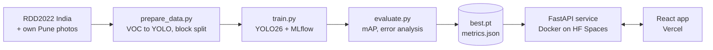

# 🛣️ RoadSense: road damage detection for Indian roads

RoadSense finds **potholes and cracks** in road photos and dashcam videos and rates the road from **Good** to **Critical**.
It's an end-to-end machine learning project: dataset preparation, model training with experiment tracking, honest evaluation, a FastAPI inference service and a React web app, packaged with Docker and tested in CI.

**Live demo:** _add your Vercel link here_ · **API docs:** _add your Hugging Face Space link_/docs

<!-- After deploying, add a real screenshot or GIF: docs/demo.gif -->

## What it does

- **Photo analysis**: draws a box around every defect, with its type and confidence, and gives a 0–100 condition score
- **Dashcam video analysis**: checks 2 frames per second, plots road condition along the route and picks out the worst stretches
- **Adjustable confidence**: a slider trades recall for precision instantly, without re-running the model
- **Exports**: download the marked-up photo or a JSON report
- **Model card**: the site shows the model's real test scores, per damage type and per lighting condition

| Class | RDD code | What it means |
|---|---|---|
| Pothole | D40 | surface broken away into a hole |
| Alligator crack | D20 | web of cracks, structural failure |
| Transverse crack | D10 | crack across the road |
| Longitudinal crack | D00 | crack along the road |

## Architecture



## Results

> Fill this in from `training/results/test/report.md` after training.

| Model | mAP@50 | mAP@50-95 | Precision | Recall |
|---|---|---|---|---|
| Baseline (YOLO26n, default settings) | – | – | – | – |
| Improved (YOLO26s + road-specific augmentation) | – | – | – | – |

**Per class** and **error analysis** (recall on dark vs bright photos, small vs large defects) are in the report and on the site's model card.

## Key decisions 

- **Block splitting, not random splitting.** RDD images are consecutive dashcam frames. A random split puts near-identical frames in both train and test, which inflates the scores. `prepare_data.py` groups every 50 consecutive frames and splits by group.
- **Baseline first.** Every improvement is measured against a plain fine-tuned YOLO26n, and all runs are tracked in MLflow.
- **Road-specific augmentation.** Stronger brightness jitter (shadows, evening light), mild rotation (tilted phone) and mixup.
- **Error analysis beyond mAP.** Recall by lighting and object size shows *where* the model fails, not only how often.
- **Condition score.** Detections are weighted by danger (potholes > alligator cracks > single cracks), confidence and size, then squashed to 0–100 so many hairline cracks can't outscore one big pothole.
- **The API returns low-confidence detections and the UI filters them**, so the confidence slider updates instantly with no extra requests.
- **CPU-only PyTorch in Docker** keeps the image small enough for free hosting.

## Project structure

```
roadsense/
├── training/            # data prep, training, evaluation, Colab notebook
├── backend/             # FastAPI app, tests, Dockerfile, weights/
├── frontend/            # React + Vite web app
├── .github/workflows/   # CI: tests, frontend build, Docker build
├── DEPLOY.md            # step-by-step deployment guide
└── docker-compose.yml
```

## Run it locally

**1. Train** (free GPU on Google Colab): open `training/roadsense_colab.ipynb` in Colab, run all cells, then put the downloaded `best.pt` and `metrics.json` into `backend/weights/`.

Or on your own machine:

```bash
cd training
pip install -r requirements.txt
python prepare_data.py --countries India
python train.py --preset baseline --device mps     # mps = Apple Silicon GPU, 0 = NVIDIA GPU
python train.py --preset improved --device mps
python evaluate.py
mlflow ui --backend-store-uri ./mlruns             # compare runs at http://127.0.0.1:5000
```

**2. API**

```bash
cd backend
python -m venv .venv && source .venv/bin/activate
pip install -r requirements.txt
uvicorn app.main:app --reload --port 8000          # http://localhost:8000/docs
```

**3. Web app**

```bash
cd frontend
cp .env.example .env
npm install
npm run dev                                        # http://localhost:5173
```

**Tests:** `cd backend && pip install -r requirements-dev.txt && pytest`

## Adding your own photos

1. Take photos of damaged roads (safely, as a passenger or on foot).
2. Upload them to a [Roboflow](https://roboflow.com) project and label boxes with the class names `pothole`, `alligator_crack`, `transverse_crack` and `longitudinal_crack`.
3. Export in **YOLOv8** format, unzip, and run `python prepare_data.py --countries India --extra path/to/export`.
4. The export's `test` folder becomes a separate `pune_test` split: `python evaluate.py --data ../datasets/roadsense/data_pune.yaml --tag pune` shows how well the model transfers to your city.

## Tech stack

Python · PyTorch · Ultralytics YOLO26 · OpenCV · MLflow · FastAPI · React · Vite · Docker · GitHub Actions · Hugging Face Spaces · Vercel

## Credits

Dataset: **RDD2022**. D. Arya, H. Maeda, S. K. Ghosh, D. Toshniwal, Y. Sekimoto, *RDD2022: A multi-national image dataset for automatic road damage detection*, Geoscience Data Journal, 2024. Images are licensed under [CC BY-SA 4.0](https://creativecommons.org/licenses/by-sa/4.0/).

Code: MIT License. Built by [Tejasav Bishnoi](https://github.com/tejasavbishnoi).
