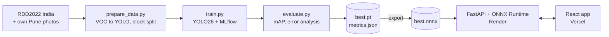
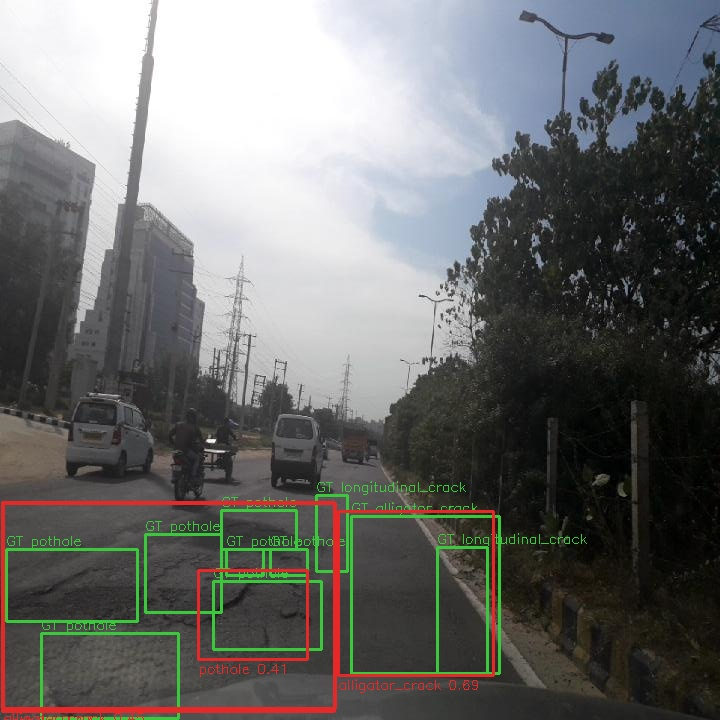
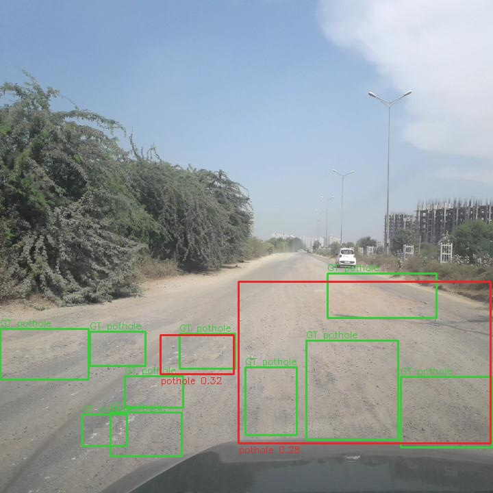
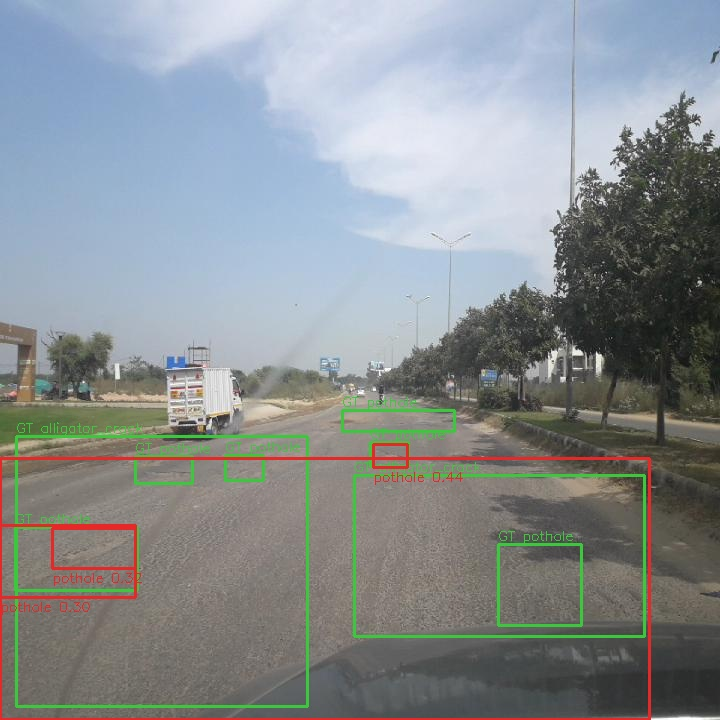

# 🛣️ RoadSense: road damage detection for Indian roads

RoadSense finds **potholes and cracks** in road photos and dashcam videos and rates the road from **Good** to **Critical**.
It's an end-to-end machine learning project: dataset preparation, model training with experiment tracking, honest evaluation, a FastAPI inference service and a React web app, packaged with Docker and tested in CI.

**Live demo:** [roadsense-tejasav.vercel.app](https://roadsense-tejasav.vercel.app) · **API docs:** [roadsense-api.onrender.com/docs](https://roadsense-api.onrender.com/docs)

> The API runs on a free server that sleeps when idle, so the first request can take about a minute.

<!-- After deploying, add a real screenshot or GIF: docs/demo.gif -->

## What it does

- **Photo analysis**: draws a box around every defect, with its type and confidence, and gives a 0–100 condition score
- **Dashcam video analysis**: checks 2 frames per second, plots road condition along the route and picks out the worst stretches
- **Adjustable confidence**: a slider trades recall for precision instantly, without re-running the model
- **Exports**: download the marked-up photo or a JSON report
- **Model card**: the site shows the model's real test scores, per damage type and per lighting condition

| Class | RDD code | What it means |
|---|---|---|
| Pothole | D40 | surface broken away into a hole |
| Alligator crack | D20 | web of cracks, structural failure |
| Transverse crack | D10 | crack across the road |
| Longitudinal crack | D00 | crack along the road |

## Architecture



## Results

Evaluated on **400 held-out test images** (block split, never seen in training). Training set: 3,000 images from RDD2022 India.

| Model | mAP@50 | mAP@50-95 | Precision | Recall |
|---|---|---|---|---|
| **YOLO26n, default augmentation (shipped)** | **0.423** | **0.188** | **0.572** | **0.377** |
| YOLO26s, heavier road-specific augmentation | 0.406 | 0.164 | 0.499 | 0.377 |

**The bigger model with heavier augmentation did not win.** With only 3,000 training images, the larger YOLO26s has more capacity than the data supports, and the stronger brightness and mixup augmentation may blur thin cracks. The smaller model scores higher and runs about 3× faster on CPU, so it is the one deployed. Both runs are logged in MLflow.

**Per damage type (shipped model)**

| Damage | Precision | Recall | AP@50 | Test instances |
|---|---|---|---|---|
| Alligator crack | 0.722 | 0.646 | **0.720** | 205 |
| Pothole | 0.617 | 0.397 | 0.468 | 337 |
| Longitudinal crack | 0.536 | 0.320 | 0.349 | 153 |
| Transverse crack | 0.411 | 0.143 | 0.156 | 7 |

**Where it struggles** (recall at confidence 0.25, IoU 0.5)

| Slice | Recall | Instances |
|---|---|---|
| Dark photos | 0.380 | 179 |
| Normal photos | 0.539 | 241 |
| Bright photos | 0.461 | 282 |
| Small defects (< 32×32 px) | 0.429 | 35 |
| Medium defects | 0.357 | 286 |
| Large defects (> 96×96 px) | 0.554 | 381 |

**What the numbers say**

- **Alligator cracks are easiest** (AP@50 0.72): large, textured and visually distinctive.
- **Transverse cracks are weakest** (AP@50 0.16) because there are only 56 training examples against 1,286 longitudinal ones. That's a data problem; more examples or oversampling that class is the fix.
- **Dark photos lose about 16 points of recall** compared with normal lighting (0.38 vs 0.54), the clearest weakness to target next.
- **Medium-sized defects are hard** (recall 0.36). They are mostly thin cracks, where a slightly-off box fails the 50% overlap test.
- **Precision is higher than recall**: when the model flags damage it is usually right, but it misses some. Lowering the confidence threshold (the slider on the site) trades precision for recall.

**Next experiments:** oversample transverse cracks, add the Czech and Japan subsets of RDD2022 for more data, and add my own night-time Pune photos.

Example failures (green = ground truth, red = prediction):

<p>
  
  
  
</p>

Full report: [`docs/eval/report.md`](docs/eval/report.md). The live site's model card shows the same numbers.

## Key decisions 

- **Block splitting, not random splitting.** RDD images are consecutive dashcam frames. A random split puts near-identical frames in both train and test, which inflates the scores. `prepare_data.py` groups every 50 consecutive frames and splits by group.
- **Baseline first.** Every change is measured against a plain fine-tuned YOLO26n, and all runs are tracked in MLflow. That's how I found that the bigger model didn't help.
- **Tested road-specific augmentation, and kept the simpler model.** Stronger brightness jitter (shadows, evening light), mild rotation (tilted phone) and mixup, combined with a bigger model, scored lower than the baseline on this dataset size, so the baseline ships.
- **Error analysis beyond mAP.** Recall by lighting and object size shows *where* the model fails, not only how often.
- **Condition score.** Detections are weighted by danger (potholes > alligator cracks > single cracks), confidence and size, then squashed to 0–100 so many hairline cracks can't outscore one big pothole.
- **The API returns low-confidence detections and the UI filters them**, so the confidence slider updates instantly with no extra requests.
- **ONNX export for deployment.** The API runs the model with ONNX Runtime instead of PyTorch: about 150 MB of RAM instead of about 1 GB, so it fits a free 512 MB server. `scripts/check_onnx.py` checks that the export gives the same detections as the PyTorch model.

## Project structure

```
roadsense/
├── training/            # data prep, training, evaluation, Colab notebook
├── backend/             # FastAPI app, tests, Dockerfile, weights/
├── frontend/            # React + Vite web app
├── .github/workflows/   # CI: tests, frontend build, Docker build
├── DEPLOY.md            # step-by-step deployment guide
└── docker-compose.yml
```

## Run it locally

**1. Train** (free GPU on Google Colab): open `training/roadsense_colab.ipynb` in Colab, run all cells, then put the downloaded `best.pt` and `metrics.json` into `backend/weights/`.

Or on your own machine:

```bash
cd training
pip install -r requirements.txt
python prepare_data.py --countries India
python train.py --preset baseline --device mps     # mps = Apple Silicon GPU, 0 = NVIDIA GPU
python train.py --preset improved --device mps
python evaluate.py
mlflow ui --backend-store-uri ./mlruns             # compare runs at http://127.0.0.1:5000
```

**2. API**

```bash
cd backend
python -m venv .venv && source .venv/bin/activate
pip install -r requirements.txt
uvicorn app.main:app --reload --port 8000          # http://localhost:8000/docs
```

**3. Web app**

```bash
cd frontend
cp .env.example .env
npm install
npm run dev                                        # http://localhost:5173
```

**Tests:** `cd backend && pip install -r requirements-dev.txt && pytest`

## Adding your own photos

1. Take photos of damaged roads (safely, as a passenger or on foot).
2. Upload them to a [Roboflow](https://roboflow.com) project and label boxes with the class names `pothole`, `alligator_crack`, `transverse_crack` and `longitudinal_crack`.
3. Export in **YOLOv8** format, unzip, and run `python prepare_data.py --countries India --extra path/to/export`.
4. The export's `test` folder becomes a separate `pune_test` split: `python evaluate.py --data ../datasets/roadsense/data_pune.yaml --tag pune` shows how well the model transfers to your city.

## Tech stack

Python · PyTorch · Ultralytics YOLO26 · OpenCV · MLflow · FastAPI · React · Vite · ONNX Runtime · Docker · GitHub Actions · Render · Vercel

## Credits

Dataset: **RDD2022**. D. Arya, H. Maeda, S. K. Ghosh, D. Toshniwal, Y. Sekimoto, *RDD2022: A multi-national image dataset for automatic road damage detection*, Geoscience Data Journal, 2024. Images are licensed under [CC BY-SA 4.0](https://creativecommons.org/licenses/by-sa/4.0/).

Code: MIT License. Built by [Tejasav Bishnoi](https://github.com/tejasavbishnoi).
